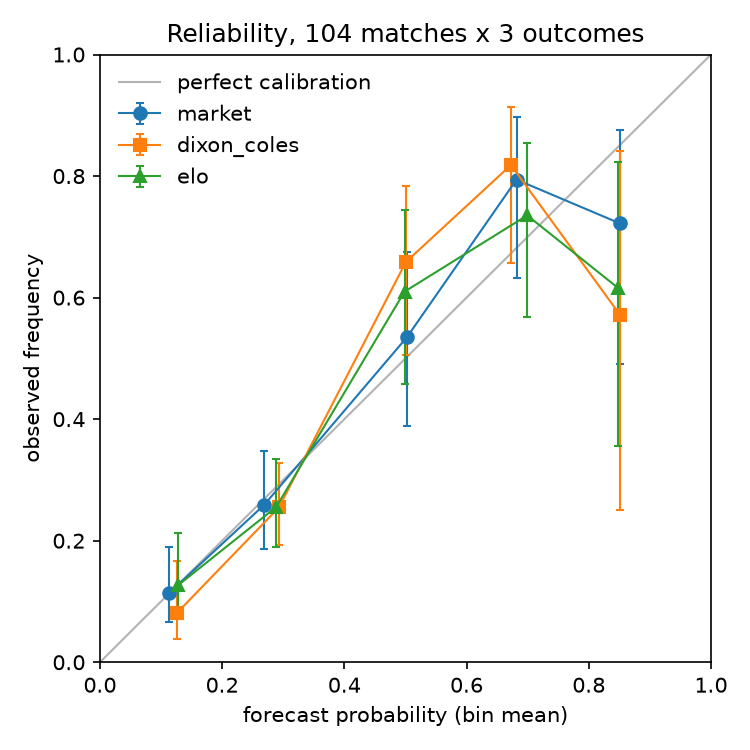

# sports-market-calibration

Are Polymarket's pre-match prices for the 2026 FIFA World Cup calibrated probabilities, and are they better than Elo and Poisson models fitted on past results?

**Short answer.** Over 104 matches, the market had the best score of the five forecasters on all three scoring rules. Its lead over a Dixon–Coles model fitted on results alone was 0.011 Brier points, with a 95% interval from −0.042 to +0.021, so the sample cannot separate the two. The market did beat Elo on log loss, with an interval that excludes zero. There is no detectable favourite–longshot bias in the market prices.

## Run it

```bash
uv sync --extra plot
uv run smcal data       # ~2.5 min: results file + Polymarket prices for 104 matches (cached)
uv run smcal tune       # ~1 min: hyperparameters from pre-2026 data -> config/frozen.json
uv run smcal forecast   # model forecasts for each match, from earlier matches only
uv run smcal evaluate   # every table in results/ and results/reliability.png
uv run pytest
```

No keys are needed. `smcal data` reads Polymarket's public endpoints at five requests per second at most. Price series are cached in `data/`, which is not committed (see [Data](#data)). `smcal tune` rewrites `config/frozen.json`; on the pinned data it reproduces the committed values.

## What is compared

| Forecaster | Information | Description |
| --- | --- | --- |
| Market | Everything public up to an hour before kickoff | Time-weighted average of each outcome's price from 120 to 60 minutes before kickoff, normalized to sum to one |
| Dixon–Coles | Past international results only | Poisson goals with team attack and defence, home advantage, time decay, a ridge penalty, and the low-score correction of Dixon and Coles (1997) |
| Poisson | Same | Dixon–Coles without the correction |
| Elo | Same | World Football Elo ratings, with a symmetric ordered logit to turn a rating difference into win, draw and loss probabilities |
| Baseline | World Cup draw rate | The draw rate from the 1998–2022 World Cups, with the rest split evenly between the sides |

Every model forecast uses only matches before the match's local date. A test sets a match's own result, and every later one, to 9–0 and checks that the forecast does not move. Hyperparameters were tuned on 2023–2025 matches and frozen in [`config/frozen.json`](config/frozen.json) before any World Cup match was scored.

The outcome is the 90-minute result, because that is what every Polymarket match market settles on. The results file records scores after extra time. In five knockout matches the market resolved as a draw while the full-time score shows a winner. Those matches are scored as draws.

## Results

Sample: 104 matches. At 90 minutes there were 46 home wins, 29 draws and 29 away wins (the "home" side is as listed by Polymarket; only the three host nations played at home). All matches were priced and none excluded ([`results/exclusions.csv`](results/exclusions.csv)). Intervals are 95% percentile intervals from 10,000 bootstrap resamples of matches.

### Scores (lower is better)

| Forecaster | Brier | Log loss | RPS |
| --- | --- | --- | --- |
| Market | **0.498** (0.417–0.579) | **0.843** (0.730–0.957) | **0.150** (0.126–0.174) |
| Dixon–Coles | 0.508 (0.444–0.573) | 0.855 (0.769–0.941) | 0.154 (0.135–0.173) |
| Poisson | 0.509 (0.443–0.575) | 0.859 (0.770–0.948) | 0.154 (0.136–0.173) |
| Elo | 0.529 (0.451–0.610) | 0.898 (0.787–1.013) | 0.163 (0.138–0.188) |
| Baseline | 0.665 (0.640–0.689) | 1.096 (1.056–1.136) | 0.231 (0.221–0.241) |

The intervals for single scores overlap heavily because they include match-to-match luck that affects every forecaster equally. Paired differences remove that shared noise:

### Paired differences (n = 104)

| Comparison | Score | A − B | 95% interval |
| --- | --- | --- | --- |
| Market − Dixon–Coles | Brier | −0.011 | −0.042 to +0.021 |
| Market − Elo | Log loss | −0.055 | −0.103 to −0.009 |
| Dixon–Coles − Poisson | Log loss | −0.004 | −0.010 to +0.001 |
| Dixon–Coles − Elo | Log loss | −0.043 | −0.090 to +0.001 |
| Elo − Baseline | Brier | −0.135 | −0.200 to −0.069 |

The first row is the main comparison, between the market and the strongest results-only model. The full grid of 54 paired intervals (three scores × three subsets × six pairs) is in [`results/pairs.csv`](results/pairs.csv). With that many intervals, a few would exclude zero by chance alone. Split by stage, the market minus Dixon–Coles Brier difference is −0.013 over the 72 group matches and −0.005 over the 32 knockout matches; both intervals include zero.

### Calibration



Each match contributes three forecast–outcome pairs, pooled into five probability bins with Wilson intervals ([`results/reliability.csv`](results/reliability.csv)). The intervals treat the three outcomes of a match as independent, so they are somewhat too narrow.

A one-parameter check uses all forecasts at once. Fit α in q ∝ p^α. α = 1 means no gain from sharpening or flattening the forecast. α > 1 means the forecast should be sharper, which is the favourite–longshot pattern for a market.

| Forecaster | α | 95% interval |
| --- | --- | --- |
| Market | 1.08 | 0.77–1.52 |
| Dixon–Coles | 1.44 | 1.01–2.06 |
| Poisson | 1.39 | 0.98–1.97 |
| Elo | 1.04 | 0.69–1.53 |

The market shows no detectable favourite–longshot bias. The goal models look too flat on these matches: Dixon–Coles' interval just excludes 1. A plausible cause is the ridge penalty, tuned on all competitive matches since 2023, shrinking strong teams towards average more than World Cup matches warrant. This was not tested.

Draws: the market's mean draw probability was 22.6% against 27.9% observed. The gap is −5.3 points, with an interval from −14.0 to +2.8 ([`results/outcome_bias.csv`](results/outcome_bias.csv)).

The Brier decomposition is in [`results/decomp.csv`](results/decomp.csv). Its parts sum exactly to the Brier score; see [Design choices](#design-choices).

## Design choices

- **The window ends an hour before kickoff.** Line-ups come out about an hour before kickoff, and the models never see them. Ending the window there keeps the information sets closer. In this data prices barely move inside the window: in at least half of the matches, one outcome's price did not change inside the window.
- **Simple normalization.** The three prices summed to between 0.989 and 1.016. At that size, methods that shift mass away from longshots (power or Shin normalization) change probabilities by well under a percentage point.
- **The outcome comes from the market's resolution, not the results file.** Using the full-time score would mark the market wrong in the five extra-time matches. The full-time score is still used as a check: it may differ from the market only by turning a draw into a win. Any other disagreement would exclude the match. None did.
- **Paired bootstrap over matches.** A match is the resampled unit, so its three probabilities stay together. Pairing is the point: two forecasters' scores on one match are strongly correlated.
- **Brier decomposition with within-bin terms.** Murphy's reliability − resolution + uncertainty is exact only for discrete forecasts. With binned continuous forecasts, the two extra terms of Stephenson, Coelho and Jolliffe (2008) make the identity exact, and a test checks it.
- **A ridge penalty in the goal models.** Over eight years about 290 national teams appear, many rarely. The penalty shrinks them towards average and pins down the level of attack and defence, which the likelihood alone leaves free.
- **Not used:** bookmaker closing odds, which have no free source with clear terms for this tournament; a betting simulation, which is out of scope.

More detail, including the options that were dropped, is in [DECISIONS.md](DECISIONS.md).

## Data

- Results: [martj42/international_results](https://github.com/martj42/international_results), CC0-1.0, pinned to commit `ca84241`.
- Prices: Polymarket's public Gamma (`/events`, series 11433) and CLOB (`/prices-history`) endpoints, one-minute fidelity. Polymarket's terms of use (effective 2026-08-11) prohibit scraping and grant no research exception. This project uses only the documented public API endpoints, with a delay between requests well under the documented rate limits, and commits no price series: the repository contains the download code and aggregate results computed from the prices.

## Limitations

- **Sample size.** 104 matches is one tournament. The main comparison cannot tell the market from the best model, and per-stage results rest on 72 and 32 matches.
- **One market, one tournament.** The results describe Polymarket during the 2026 World Cup, not prediction markets in general.
- **Information sets differ.** The market sees injuries, form and news up to an hour before kickoff. The models see past scores only. The market's lead is expected; its size is the finding.
- **Training labels include extra time.** Historical knockout matches in the results file are recorded after extra time, so a small share of training outcomes are not 90-minute results. The baseline draw rate is understated for the same reason.
- **Prices are not pure beliefs.** Fees, spreads and capital costs move prices, most of all near 0 and 1. With prices summing to within 1.6% of one, the effect here is small.
- **Many comparisons.** Only the first paired comparison was chosen in advance as the main question. Treat the others as descriptive.
- **No profitability claim.** Nothing here says whether trading against the market would have made money. Fees, spreads and execution were not modelled.

## License

MIT. See [LICENSE](LICENSE).
